<p align="center">
  <a href="https://gitee.com/liguangni/ruoyi-plus-uni-best">
    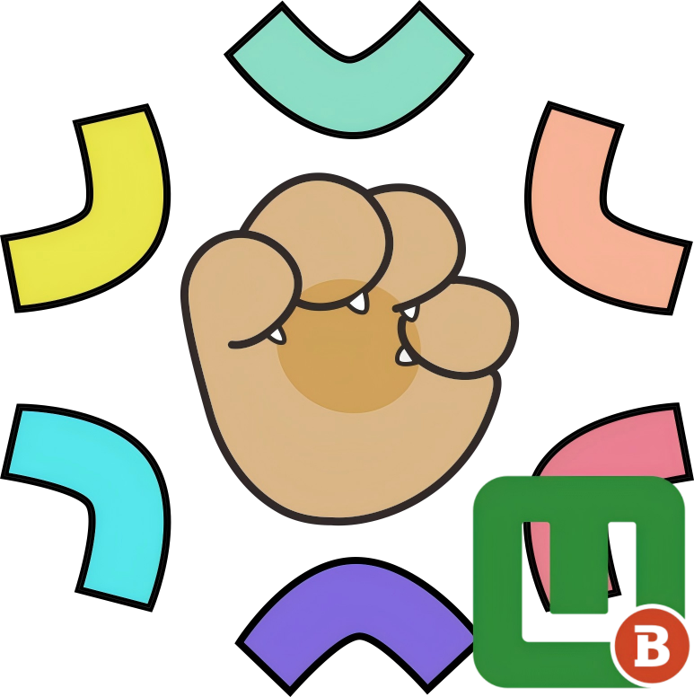
  </a>
</p>
<h1 align="center">
  <a href="https://gitee.com/liguangni/ruoyi-plus-uni-best" target="_blank" style='color: red'>Ruoyi-Plus-Uni-Best</a>
</h1>

<div align="center">
基于 <a href="https://unibest.tech/" target="_blank">unibest</a> 构建，深度适配 <a href="https://gitee.com/dromara/RuoYi-Cloud-Plus" target="_blank">RuoYi-Cloud-Plus</a> / <a href="https://gitee.com/dromara/RuoYi-Vue-Plus" target="_blank">RuoYi-Vue-Plus</a> 的 UniApp 快速开发模板
</div>
<p align="center">支持工作流管理功能</p>
<p align="center">
  <strong>🚀 开箱即用 · 📱 多端兼容 · 🎨 灵活扩展 · ⚡ 高性能</strong>
</p>


## 📖 项目介绍

- **🎯 深度适配 RuoYi-Plus**
  
  完美对接 RuoYi-Cloud-Plus / RuoYi-Vue-Plus 后端架构，提供统一的前后端开发体验

- **⚡ 基于 unibest 最佳实践**

  继承 unibest 的优秀架构设计，集成 Vite + Vue3 + TypeScript + UnoCSS 等现代前端技术栈

- **📱 多端编译支持**

  一次开发，多端运行，支持 H5、App（iOS/Android/鸿蒙）及微信小程序等各大主流小程序平台
  


## 🌿 分支说明

本项目采用与 RuoYi-Plus 主版本对齐的分支管理策略：

| 本项目分支 | Plus 后台分支 | 分支说明                                           |
| :--------: | :-----------: | -------------------------------------------------- |
|   6.X    |     6.X    | 基础功能版本（首页、登录页、个人中心、工作台等） |
|   6.X-workflow    |     6.X    | 工作流版本（包含基础功能+工作流模块） |

> 注意: 其他分支(如dev、master、feature等) 为开发测试分支,代码可能未完全测试, 不建议在生产环境中使用。


## 🎨 UI 框架选型说明
1. **基础模块：原生实现，零依赖**

   项目的核心基础页面（如首页、登录页、个人中心、工作台等）均采用原生基础组件构建, 未使用任何第三方 UI 库。

   旨在最大程度地降低UI耦合度，保持代码的纯净与轻量，方便后续的快速迁移与定制化开发。

2. **默认集成：Sard Uniapp**

   项目已默认集成 Sard Uniapp 组件库，但当前处于未使用状态。

   预留能力：该库作为底层能力储备，可用于后续的复杂业务场景（如~~工作流~~?系统管理?）。

   > update 2026-08-01: 工作流模块功能已基本搭建完成, 全部页面均采用原生组件实现, 未使用第三方组件库。

3. **灵活扩展：支持自定义替换**

   开发者可根据实际业务需求或个人技术偏好，自由集成或更换其他 UI 框架。

   操作指引：如需进行 UI 库替换，请参考 Unibest 官方文档：[UI库替换篇](https://unibest.tech/base/7-ui "UI库替换篇")。

4. **部分页面/代码的实现借鉴了优秀的开源作品**

   衷心感谢各位开发者的无私奉献。若有任何版权问题，敬请告知，我将立即处理。
   
   

## 🌐 平台兼容性

| H5   | IOS  | 安卓 | 微信小程序 | 字节小程序 | 快手小程序 | 支付宝小程序 | 钉钉小程序 | 百度小程序 |
| ---- | ---- | ---- | ---------- | ---------- | ---------- | ------------ | ---------- | ---------- |
| √    | √    | √    | √          | √          | √          | √            | √          | √          |

>  注意:
>
> 1. 每种UI框架 支持的平台有所不同，详情请看各UI框架 的官网，也可以看 unibest文档。
> 2. 这仅仅是unibest给出的说明，部分平台未进行测试，请开发者自行测试


## ⚙️ 环境

- node>=18
- pnpm>=7.30
- Vue Official>=2.1.10
- TypeScript>=5.0

## 🚀 快速开始

1️⃣ 克隆bash
```bash
# 克隆项目到本地
git clone https://gitee.com/liguangni/ruoyi-plus-uni-best.git

# 进入项目目录
cd ruoyi-plus-uni-best
```
2️⃣依赖安装
```bash
# 使用 pnpm 安装依赖（推荐使用镜像源加速）
pnpm install

# 或使用国内镜像源
pnpm install --registry=https://registry.npmmirror.com
```
3️⃣ 配置后端接口地址

修改项目中的接口配置文件（.env 相关文件），将后端地址修改为您的 RuoYi-Plus 服务地址。

4️⃣ 启动开发

```bash
# 启动 H5 开发环境
pnpm dev

# 或指定平台启动
pnpm dev:h5        # H5 平台
pnpm dev:mp-weixin # 微信小程序
pnpm dev:app       # App
```

## 📦 运行（支持热更新）

- web平台： `pnpm dev:h5`, 然后打开 [http://localhost:9000/](http://localhost:9000/)。
- weixin平台：`pnpm dev:mp` 然后打开微信开发者工具，导入本地文件夹，选择本项目的`dist/dev/mp-weixin` 文件。
- APP平台：`pnpm dev:app`, 然后打开 `HBuilderX`，导入刚刚生成的`dist/dev/app` 文件夹，选择运行到模拟器(开发时优先使用)，或者运行的安卓/ios基座。(如果是 `安卓` 和 `鸿蒙` 平台，则不用这个方式，可以把整个unibest项目导入到hbx，通过hbx的菜单来运行到对应的平台。)

## 🔗 发布

- web平台： `pnpm build:h5`，打包后的文件在 `dist/build/h5`，可以放到web服务器，如nginx运行。如果最终不是放在根目录，可以在 `manifest.config.ts` 文件的 `h5.router.base` 属性进行修改。
- weixin平台：`pnpm build:mp`, 打包后的文件在 `dist/build/mp-weixin`，然后通过微信开发者工具导入，并点击右上角的“上传”按钮进行上传。
- APP平台：`pnpm build:app`, 然后打开 `HBuilderX`，导入刚刚生成的`dist/build/app` 文件夹，选择发行 - APP云打包。(如果是 `安卓` 和 `鸿蒙` 平台，则不用这个方式，可以把整个unibest项目导入到hbx，通过hbx的菜单来发行到对应的平台。)

## ☕ 捐赠支持

如果这个项目对您有帮助，欢迎请作者喝杯咖啡 ☕

<p align="center">
  <strong>感谢您的支持与鼓励！🙏</strong>
</p>
<p align="center">
  
  
</p>


## 项目运行截图

### 基础功能
<table>
  <tr>
    <td align="center" >
      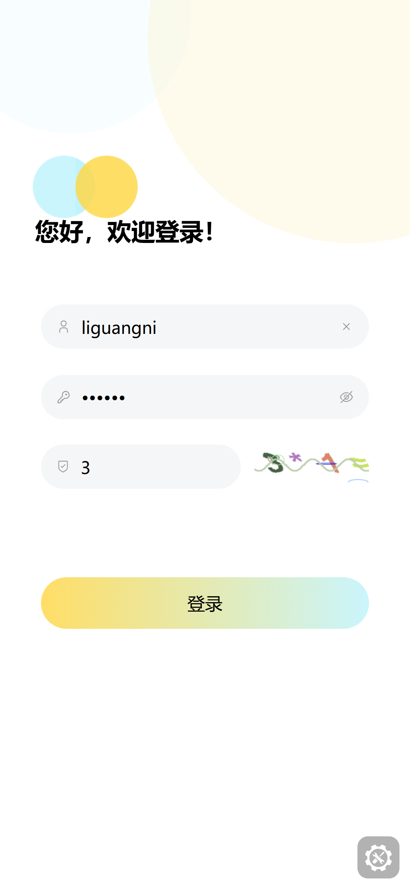
    </td>
    <td align="center">
      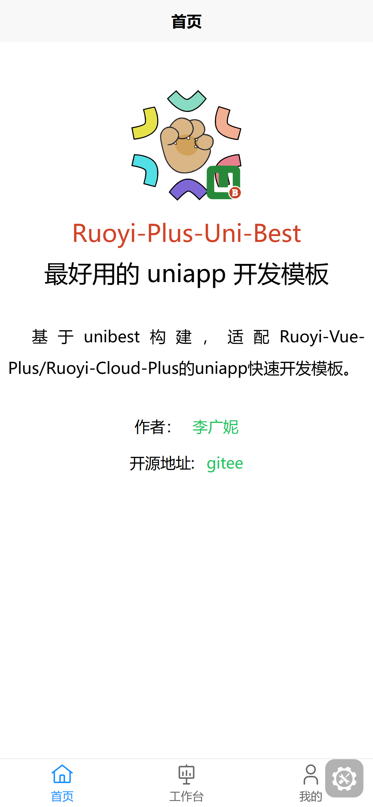
    </td>
    <td align="center">
      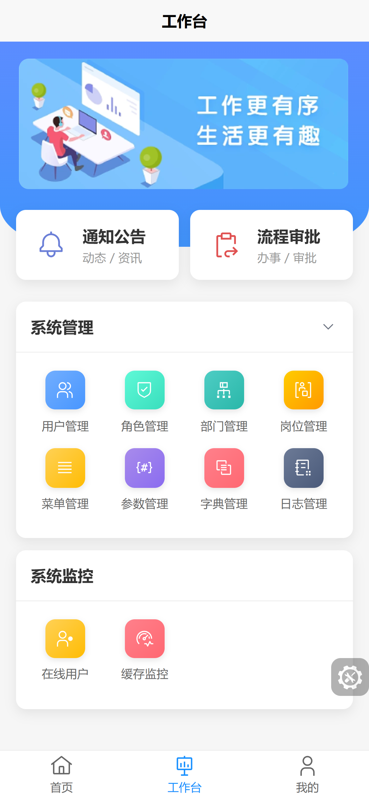
    </td>
    <td align="center" style="padding: 10px;">
      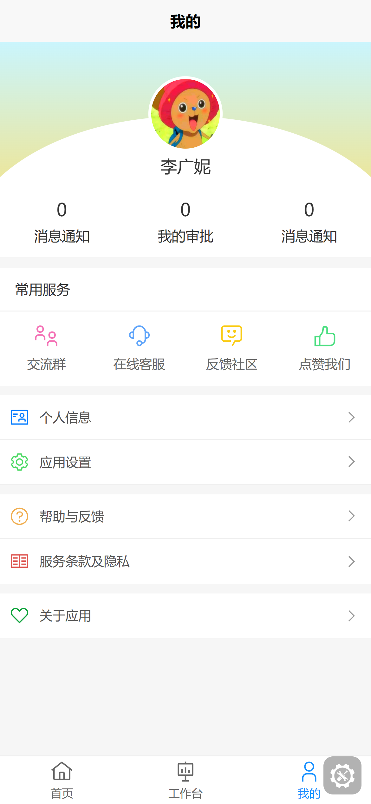
    </td>
  </tr>
  <tr>
    <td align="center" style="padding: 10px;" >登录页</td>
    <td align="center" style="padding: 10px;" >首页</td>
    <td align="center" style="padding: 10px;" >工作台</td>
    <td align="center" style="padding: 10px;" >我的</td>
  </tr>
  <tr>
    <td align="center" style="padding: 10px;">
      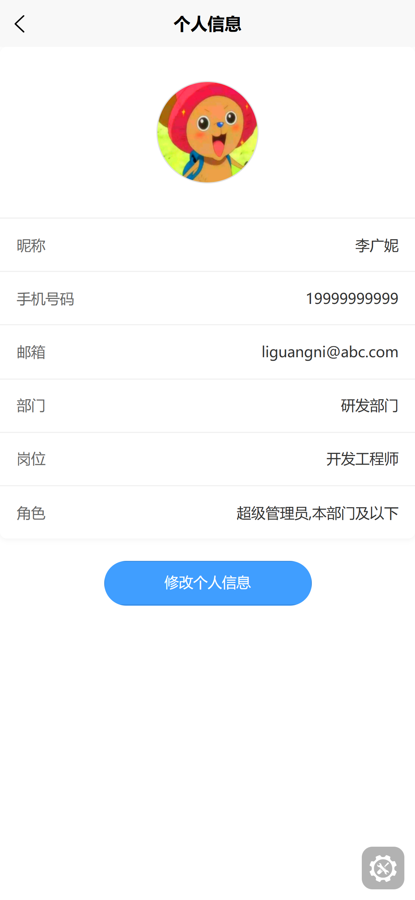
    </td>
    <td align="center" style="padding: 10px;">
      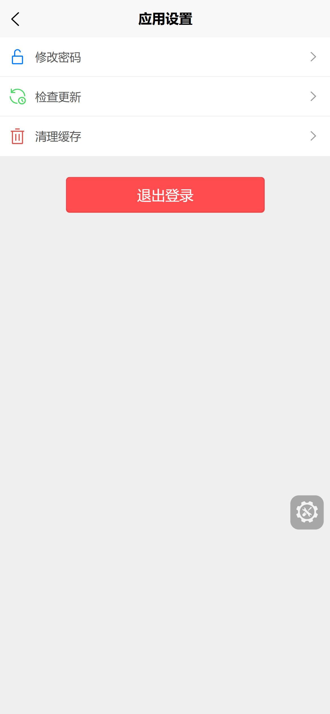
    </td>
    <td align="center" style="padding: 10px;">
      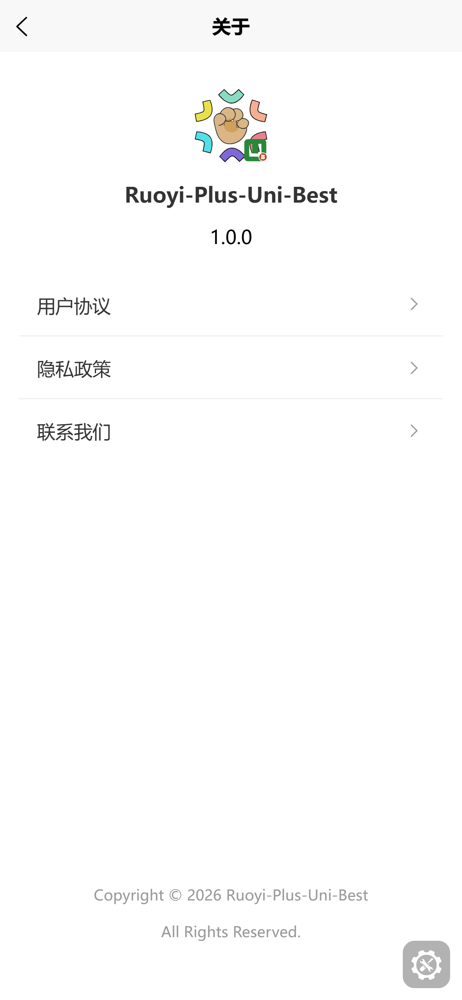
    </td>
    <td align="center" style="padding: 10px;">
      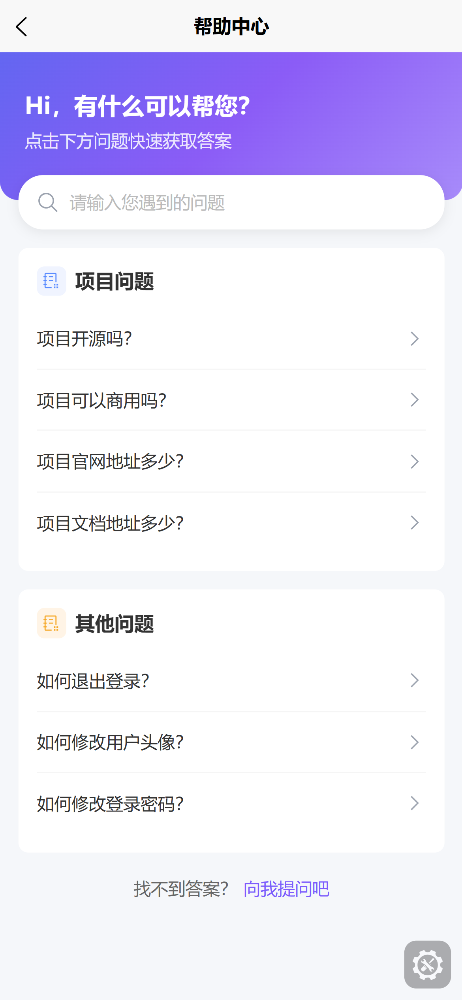
    </td>
  </tr>
  <tr>
    <td align="center" style="padding: 10px;" >个人信息</td>
    <td align="center" style="padding: 10px;" >应用设置</td>
    <td align="center" style="padding: 10px;" >关于</td>
    <td align="center" style="padding: 10px;" >帮助中心</td>
  </tr>
</table>

### 工作流功能
<table>
  <tr>
    <td align="center" >
      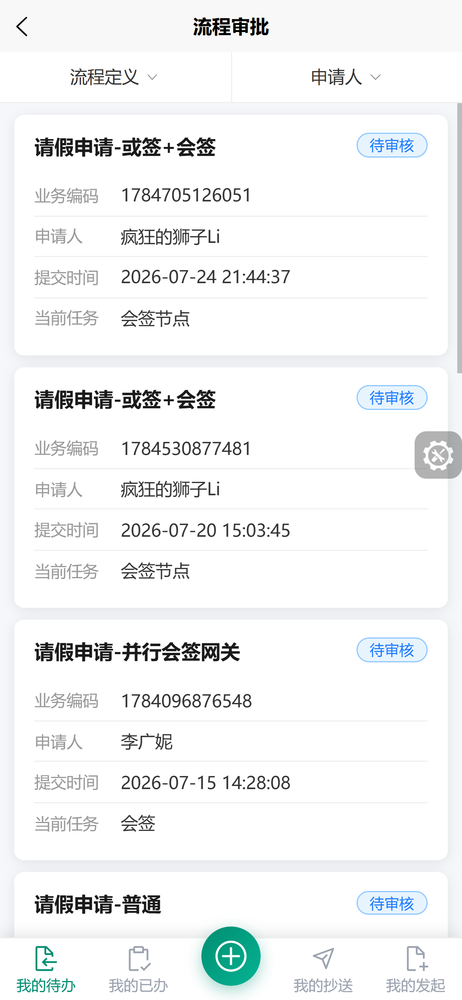
    </td>
    <td align="center">
      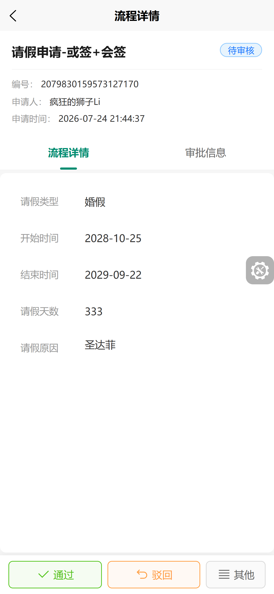
    </td>
    <td align="center">
      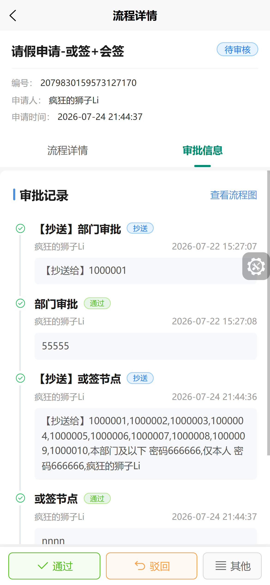
    </td>
    <td align="center" style="padding: 10px;">
      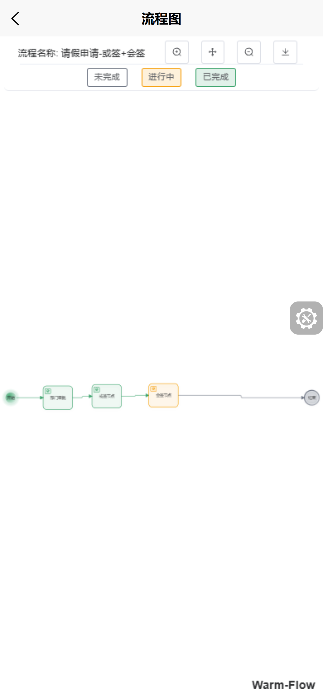
    </td>
  </tr>
  <tr>
    <td align="center" style="padding: 10px;" >审批列表</td>
    <td align="center" style="padding: 10px;" >审批详情-表单</td>
    <td align="center" style="padding: 10px;" >审批详情-审批记录</td>
    <td align="center" style="padding: 10px;" >流程详情-流程图</td>
  </tr>
  <tr>
    <td align="center" style="padding: 10px;">
      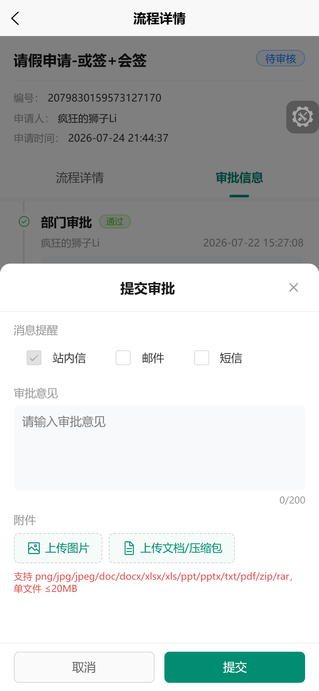
    </td>
    <td align="center" style="padding: 10px;">
      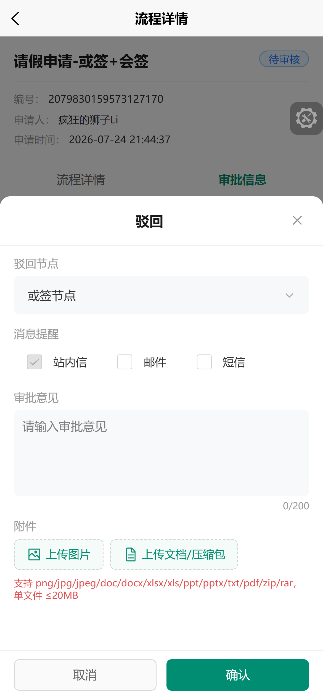
    </td>
    <td align="center" style="padding: 10px;">
      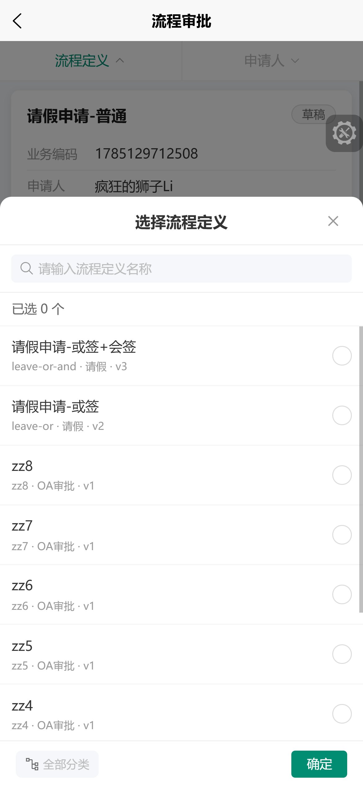
    </td>
    <td align="center" style="padding: 10px;">
      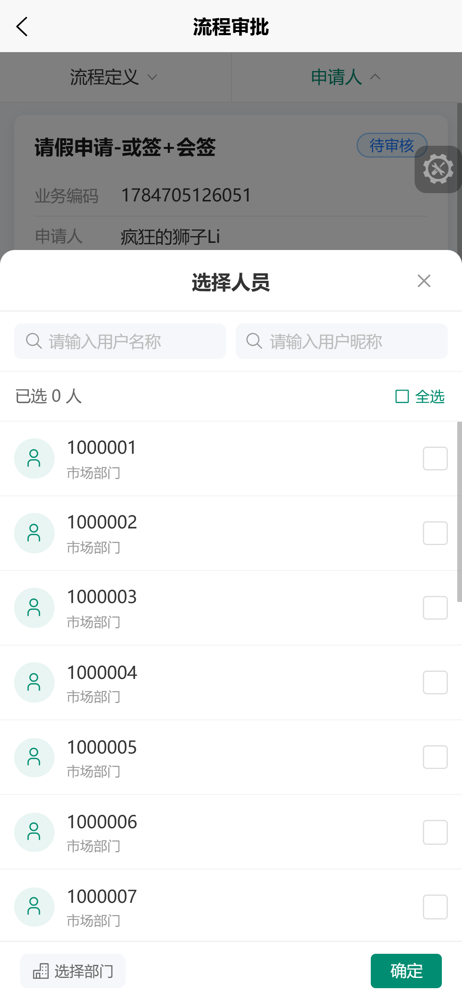
    </td>
  </tr>
  <tr>
    <td align="center" style="padding: 10px;" >流程办理-通过</td>
    <td align="center" style="padding: 10px;" >流程办理-驳回</td>
    <td align="center" style="padding: 10px;" >选择流程定义</td>
    <td align="center" style="padding: 10px;" >选择审批人</td>
  </tr>
  <tr>
    <td align="center" style="padding: 10px;">
      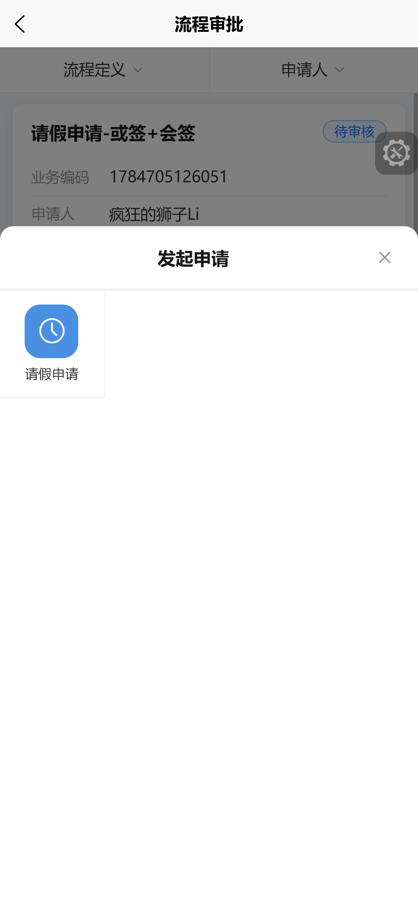
    </td>
    <td align="center" style="padding: 10px;">
      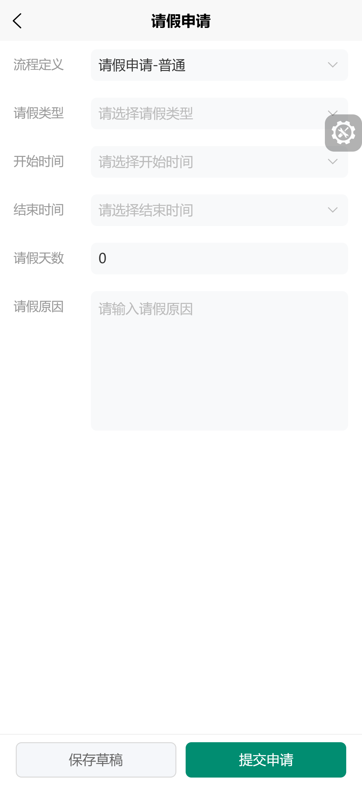
    </td>
  </tr>
  <tr>
    <td align="center" style="padding: 10px;" >流程发起-弹窗</td>
    <td align="center" style="padding: 10px;" >流程发起-请假</td>
  </tr>
</table>


---

<p align="center">
  <strong>Made with ❤️ by <a href="https://gitee.com/liguangni">liguangni</a></strong>
</p>

<p align="center">
  <a href="https://gitee.com/liguangni/ruoyi-plus-uni-best/issues">报告 Bug</a>
  ·
  <a href="https://gitee.com/liguangni/ruoyi-plus-uni-best/issues">请求特性</a>
</p